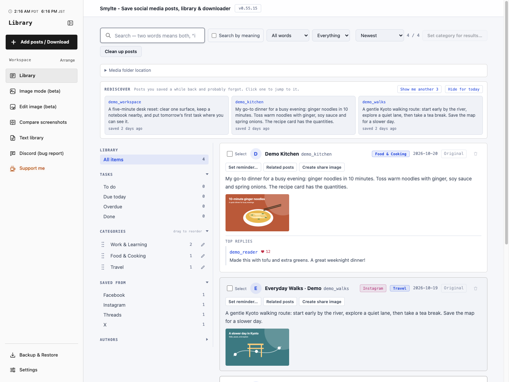
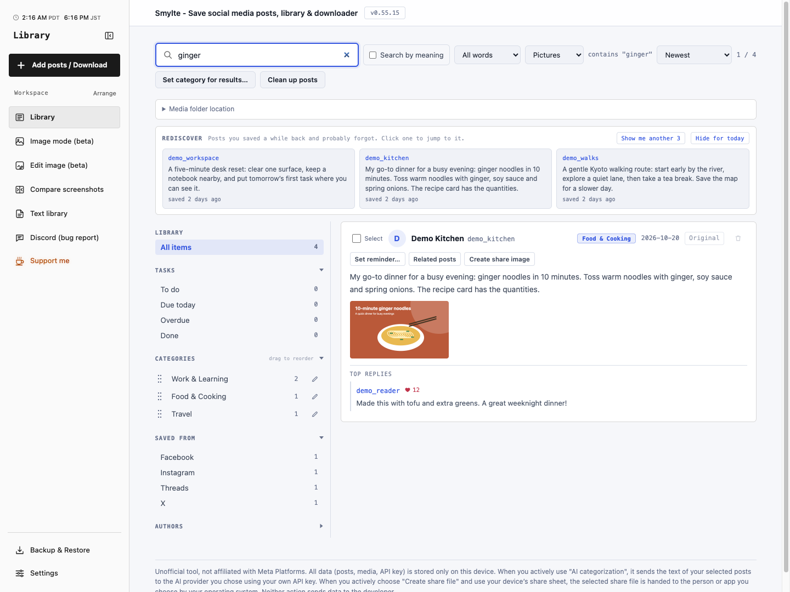
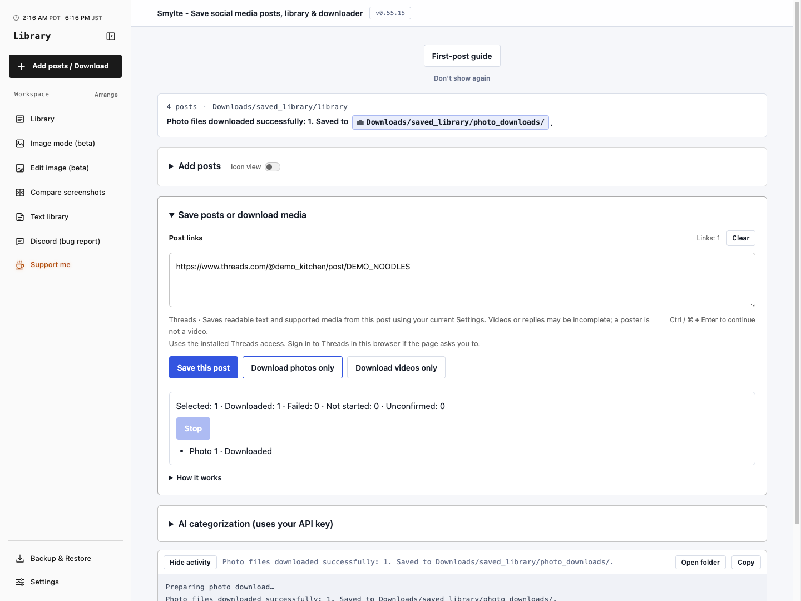

# Smylte

**Save social media posts, library & downloader**

Keep useful posts in a searchable local Library. Find saved text and words recognized in pictures, download supported photos or videos, and turn saved posts into share images.

**[Install from the Chrome Web Store](https://chromewebstore.google.com/detail/smylte-save-social-media/eebefbknmfpjmhggmcapmljjilmkoebg)** · [Product website](https://yaka310.com/projects/post-library/) · [Guides](https://yaka310.com/projects/post-library/guides/) · [繁體中文](README.zh-TW.md)

This is Smylte's public **documentation, updates and support** repository. The application is closed source. Its source code and installation packages are not distributed here.

## What you can do

- Save supported posts to your own device and browse successfully saved content offline.
- Search post text, available saved replies and recognized image text. Optional meaning search also runs locally.
- Organize your Library with categories, tags, filters, related posts and optional reminders.
- Download supported photos or videos without creating a Library record.
- Create up to 10 PNG share images from a saved post and the saved text comments you explicitly choose.
- Back up or move your Library with available media using Full Backup & Restore.

**If an original post is deleted, successfully saved content remains viewable as long as you keep your local copy.** A link or thumbnail alone is not a downloaded video. Keep backups of content you want to retain.

## Screenshots

These screenshots show the released **v0.55.15** interface with made-up posts, authors and images. No personal saved content is shown. The download example uses a local test response; it is not proof that a particular live post can be downloaded.

**Keep saved posts together**

**Find saved content by its words**

**Download media without adding a Library record**

[What these demonstrations show](SCREENSHOTS.md)

## Supported sources

Support depends on the page, your access and the content loaded during the run.

| Source | Supported uses | Guide |
| --- | --- | --- |
| **Threads** | Saved list, publicly loadable original posts from a chosen profile, and supported exact post or reply links. | [Photos and videos](https://yaka310.com/guides/download-threads-videos/) |
| **Instagram** | Saved list, chosen public profiles, and supported exact post or Reel links. | [Save and download](https://yaka310.com/projects/post-library/guides/save-instagram-posts-download-media/) |
| **Facebook** | Supported items loaded from Saved, plus supported exact text/photo posts, carousels, direct photos and Reels. | [Posts and Reels](https://yaka310.com/projects/post-library/guides/save-facebook-posts-reels/) |
| **X** | Bookmarks, Likes history, and supported exact post links. Quoted-post media and reply bodies are not copied. | [Bookmarks and media](https://yaka310.com/projects/post-library/guides/save-x-bookmarks-likes-media/) |
| **Patreon (beta)** | Accessible exact posts, creator pages and supported collections, using your existing access. | [Posts and media](https://yaka310.com/projects/post-library/guides/save-patreon-posts-media/) |
| **Pinterest** | Supported photos or videos from one Pin. **Downloads only: Pins are not added to the Library.** | [Pin downloads](https://yaka310.com/projects/post-library/guides/download-pinterest-photos-videos/) |

You can also add pictures from your computer. See the [support table](https://yaka310.com/projects/post-library/#supported-sources) and [limitations](SUPPORT.md#limits-to-keep-in-mind).

## Get started

1. Install Smylte from the Chrome Web Store and open its Library.
2. Use **Add posts / Download**. Choose a supported source, or paste a supported post link and choose a save or download action.
3. For operations that need login, sign in to the appropriate website in the same browser profile.
4. Check the result. A partial, cancelled or unconfirmed download is different from a completed download.

The interface supports English, Traditional Chinese, Simplified Chinese, Russian (Testing), Japanese and Korean.

## Privacy and AI

Library storage, image-text recognition and meaning search operate locally. No separate Smylte account is required, and Smylte does not use developer analytics or a developer relay for your saved content.

AI categorization is optional. If enabled, relevant selected text, author handles, recognized image text and category names are sent directly to Google Gemini using your own API key. Provider limits or charges may apply. You can use saving, keyword search and manual organization without an AI key. Read the [privacy summary](PRIVACY.md).

## Updates and support

- **Store version checked on October 24, 2026: v0.55.15.** The [Store listing](https://chromewebstore.google.com/detail/smylte-save-social-media/eebefbknmfpjmhggmcapmljjilmkoebg) is the place to check current availability.
- **v0.55.16 is in development** and is listed separately in [Updates](UPDATES.md).
- [Read the FAQ and troubleshooting guide](SUPPORT.md), [report a bug](https://github.com/bu56co-del/smylte/issues/new/choose), or suggest an improvement.
- [Browse website updates](https://yaka310.com/updates/).

Formerly **Post Library**. Smylte is an unofficial tool and is not affiliated with or endorsed by the supported services. Save or download only content you have the right to keep and use. See [About this repository](NOTICE.md).
